Paso 2.1 - Pruebas del comparador (ROJO)

La prueba falla porque importa lib/dominio/comparador.dart, un archivo que todavía no existe, así que ni siquiera compila. Aunque el archivo existiera, no estarían definidas las funciones normalizar, distanciaLevenshtein, similitud ni comparar. Las pruebas fijan de antemano el comportamiento esperado: el par ship/sheep, think/tink como palabra "parecida", la palabra omitida, la sobrante que resta 0.25 y el puntaje que nunca sale del rango 0 a 1.
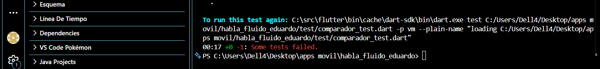

Paso 2.2 - Código del comparador (VERDE)

Se crea comparador.dart con lo mínimo necesario: normalizar (minúsculas, sin puntuación, conserva apóstrofos), la distancia de Levenshtein, la similitud y comparar, que alinea palabra por palabra con programación dinámica. Pasa porque los costos (coincidir 0, parecida 0.5, sustituir u omitir 1) y el umbral de 0.75 reproducen los valores esperados: think/tink da 0.8 y queda "parecida", ship/sheep da 0.6 y queda "sustituida". El puntaje se calcula como (correctas + 0.5 por parecidas - 0.25 por sobrantes) entre las esperadas, con límite entre 0 y 1 y retorno de 0 si no hay palabras esperadas.
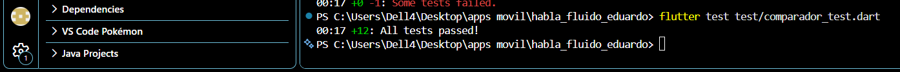

Paso 3.1 - Pruebas de repetición espaciada, progreso y plan diario (ROJO)

La prueba falla porque repaso_progreso_test.dart importa repaso.dart, progreso.dart y plan_diario.dart, ninguno de los cuales existe aún, y por eso no compila. Las pruebas ya definen los números exactos que se deben obtener: la secuencia SM-2 con calificaciones 4, 5, 5, 2 (intervalos 1, 6, 16, 1 y facilidades 2.5, 2.6, 2.7, 2.38), la facilidad mínima de 1.3, el promedio móvil exponencial de 30%, la racha de días, el requisito de subir de nivel en todas las habilidades y el reparto de minutos que siempre suma el total pedido.
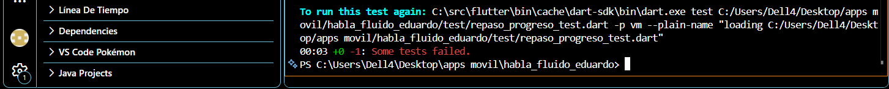

Paso 3.2 - Código de repaso, progreso y plan diario (VERDE)

Se escriben repaso.dart (TarjetaRepaso, calidadDesdePuntaje y MazoRepaso), progreso.dart y plan_diario.dart. Pasa porque calificar aplica la fórmula de SM-2 tal cual (1 día, luego 6, luego intervalo por facilidad redondeado: 6 x 2.6 = 15.6, es decir 16) y limita la facilidad a 1.3 como mínimo. Progreso calcula el promedio ponderado con 0.7 y 0.3, cuenta la racha con fechas en UTC y exige dominio e intentos en todas las habilidades para subir. generarPlan aplica el método del mayor resto, por lo que los minutos enteros siempre suman exactamente el total.
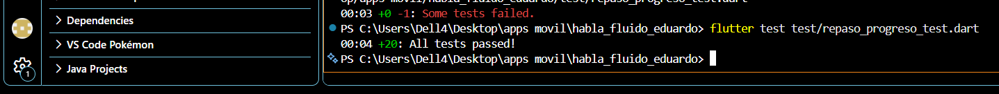

Paso 6.1 - Pruebas del proxy (ROJO)

La prueba falla porque proxy/test/proxy.test.js carga ../prompt y ../server, módulos que no existen, y node --test termina con un error de módulo no encontrado antes de ejecutar las 12 pruebas. Estas definen el comportamiento del servidor usando un modelo falso, sin internet: el prompt con las reglas pedagógicas y la defensa contra inyección, la validación de la solicitud, la extracción del JSON de la respuesta, el error 502 sin filtrar detalles, el límite de 429 y el token de aplicación con 401.
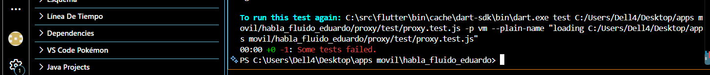

Paso 6.2 - Implementación del proxy (VERDE)

Se crean prompt.js (construirPrompt, validarSolicitud, extraerRespuesta) y server.js (crearServidor). Pasa porque la función que llama al modelo se recibe como parámetro (fetchFn), de modo que la prueba la sustituye por una falsa y el servidor se verifica de punta a punta sin red. Cada código de estado sale de una regla concreta: 400 por solicitud inválida, 401 por token incorrecto, 429 al superar el límite por minuto y 502 con mensaje genérico cuando el modelo falla o devuelve algo que no es JSON válido.
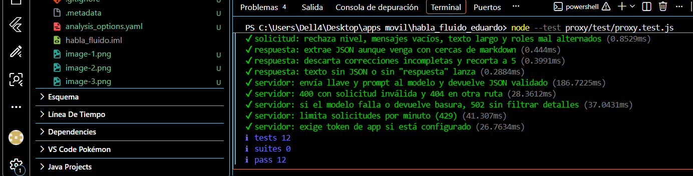

Paso 7.1 - Pruebas del tutor simulado y del cliente HTTP (ROJO)

La prueba falla porque test/tutor_test.dart importa tutor_simulado.dart y tutor_http.dart, que todavía no existen, y el archivo no compila. Las pruebas definen lo que se exige: corregir "I am agree" y "he go", máximo 2 correcciones por turno, aceptar solo HTTPS (o http local si se autoriza), recortar el historial a 20 mensajes y 500 caracteres, convertir fallas de red o estados distintos de 200 en TutorNoDisponible, y respetar acentos y la ñ.
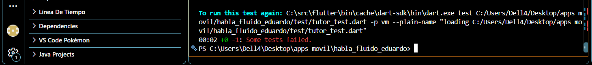

Paso 7.2 - Código del tutor simulado y del cliente HTTP (VERDE)

Se escriben TutorSimulado, con reglas de expresiones regulares y un tope de 2 correcciones, y TutorHttp, que valida el esquema de la dirección, recorta el historial y garantiza que el primer mensaje sea del estudiante. Pasa porque cada prueba corresponde a una regla del código: el constructor lanza ArgumentError si la dirección no es segura, cualquier falla de red o estado distinto de 200 se traduce a TutorNoDisponible, una respuesta mal formada a TutorInvalido, y la respuesta se decodifica con utf8.decode(bodyBytes), lo que conserva los acentos. MockClient permite verificarlo todo sin conexión.
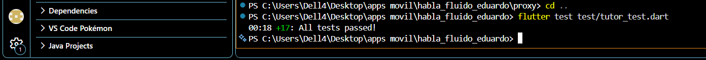

Paso 9.1 - Pruebas de los ViewModels (ROJO)

La prueba falla porque test/vms_test.dart importa los siete ViewModels y AlmacenAvanceMemoria, que aún no existen, y por tanto no compila. Las pruebas describen comportamientos finos que deben cumplirse: silencio del micrófono sin registrar intento, doble toque ignorado mientras la voz habla, lectura que solo puntúa una vez, texto de escritura con menos de 5 palabras rechazado, y un tutor que falla sin duplicar roles en el historial ni mostrar detalles internos.
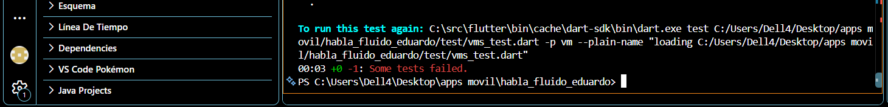

Paso 9.2 - Código de los ViewModels (VERDE)

Se escribe AprendizajeViewModel como núcleo (progreso, mazo y guardado) y los ViewModels de pronunciación, dictado, lectura, escritura, conversación y repaso, además de almacen_avance.dart. Pasa porque cada comportamiento de la prueba tiene su protección en el código: la bandera ocupado ignora el doble toque, mensajeSeguro oculta los errores internos, el guardado va dentro de un try/catch para no interrumpir la práctica, la conversación retira el mensaje fallido y conserva textoNoEnviado, y el repaso exige mostrar la respuesta antes de calificar y regresa a la cola las tarjetas con calidad menor a 3.
A
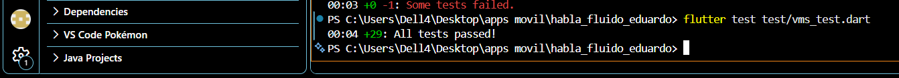

##todos los pasos siendo exitosos
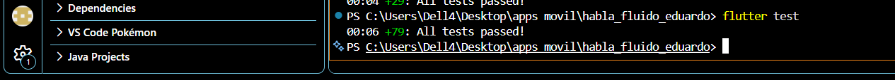

##app funcionando
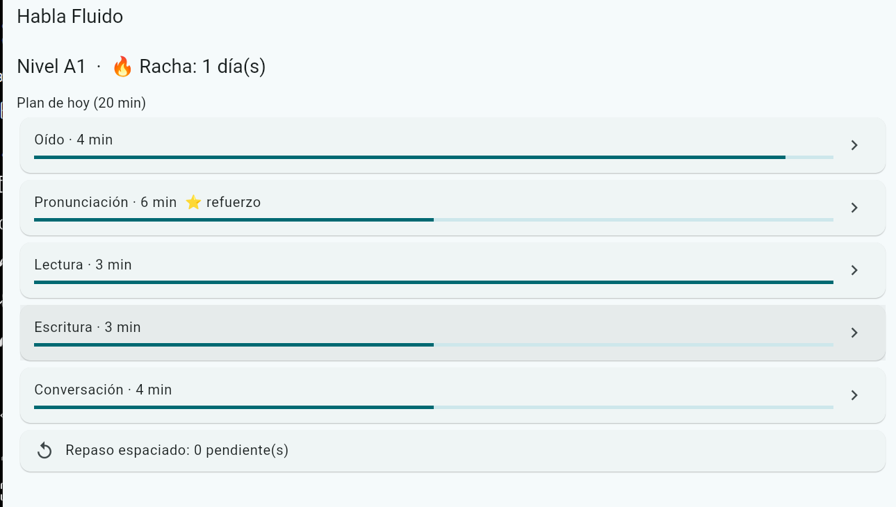